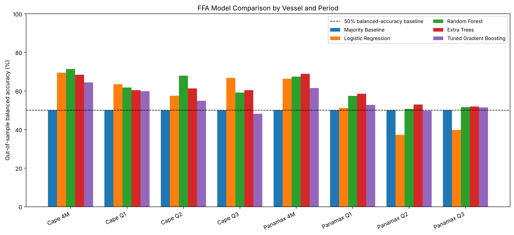

# Forecasting Dry-Bulk Freight Futures (FFA): Direction Classification with Leakage-Aware Evaluation

A small research project that tests whether simple technical features contain out-of-sample
information about the direction of Forward Freight Agreement (FFA) prices for Capesize and
Panamax vessels at quarterly and four-month horizons.

**Short answer:** a modest signal at the +4MON horizon, weaker than a single test period suggests.
On one held-out test period, balanced accuracy was 65-72% versus 50% for a naive baseline. Across
18 six-month walk-forward test blocks (2016-2025 for Capesize), the best case is Capesize +4MON at 0.64
(95% CI 0.57-0.71), while a naive model that predicts the most recent majority direction already
scores 0.58. At the +1Q to +3Q horizons the evidence is weak or absent.
The project's main contribution is the evaluation design, not a trading strategy.

## Question

Can price-history features predict whether an FFA contract will be higher or lower
63 trading days (about one quarter) or 84 trading days (about four months) ahead?

## Data

Daily Baltic Exchange FFA history (5TC Capesize from 2014, 5TC Panamax from 2019, to April 2026),
contracts +1Q, +2Q, +3Q and +4MON.

**The data is not included in this repository** (licensed by the Baltic Exchange).
To reproduce, place the two Excel exports in the project folder; `ffa_panel.py` detects the vessel
class from the file name and the contract from the `Route-Period` column.

## Method

- **Features (6):** 1/5/20-day returns, 5/20-day moving-average gap, 20-day volatility, RSI(14). All are
  relative measures; the raw price level is excluded because it is non-stationary (see below).
- **Target:** price higher after the horizon (1) or not (0).
- **Split:** chronological 60% / 20% / 20% (train / validation / test), with a **purge gap equal to the
  forecast horizon** at each boundary so that no label reaches into the next period.
- **Models, identical for every experiment:** majority baseline, logistic regression, random forest,
  extra trees, gradient boosting (grid-searched with `TimeSeriesSplit`).
- **Selection:** deployment model and trading threshold chosen **on validation data only**.
  Test results are reported for every candidate, not just the winner.
- **Metric:** balanced accuracy (the up/down classes are imbalanced in some windows), with a majority
  baseline for reference.
- **Backtest check:** non-overlapping horizon trades, 50-point transaction cost per side, position size
  scaled by model confidence.
- **Walk-forward check:** expanding training window (at least 504 trading days), test blocks of 126
  trading days, purge gap equal to the horizon, every model refitted from scratch for each block.

## Results (deployment model chosen on validation, evaluated on the untouched test set)

| Vessel | Horizon | Model | Validation bal. acc. | **Test bal. acc.** | Test 95% CI (block bootstrap) |
|---|---|---|---|---|---|
| Capesize | +1Q | Logistic Regression | 0.61 | 0.66 | 0.53 - 0.75 |
| Capesize | +2Q | Gradient Boosting | 0.56 | 0.47 | 0.35 - 0.59 |
| Capesize | +3Q | Logistic Regression | 0.56 | 0.49 | 0.35 - 0.59 |
| Capesize | **+4MON** | Logistic Regression | 0.64 | **0.72** | 0.57 - 0.83 |
| Panamax | +1Q | Logistic Regression | 0.74 | 0.55 | 0.43 - 0.66 |
| Panamax | +2Q | Majority baseline (no model beat it on validation) | 0.50 | 0.50 | - |
| Panamax | +3Q | Extra Trees | 0.64 | 0.59 | 0.51 - 0.67 |
| Panamax | **+4MON** | Logistic Regression | 0.78 | **0.65** | 0.49 - 0.75 |

The intervals use a moving-block bootstrap with block length equal to the forecast horizon, because
overlapping labels are strongly autocorrelated and an ordinary bootstrap would make them far too narrow.



Full per-model results are in [`results/FFA_Model_Comparison.csv`](results/FFA_Model_Comparison.csv); backtest and data-quality summaries are in the same folder.

### What the results say

1. **The only consistent out-of-sample edge is at the 4-month horizon.** Every non-baseline model scores
   0.64-0.73 on the test set for both vessel classes. The Capesize interval stays above 50% (0.57-0.83);
   the Panamax interval just touches it (0.49-0.75). The edge is plausible, not proven.
2. **At quarterly horizons the signal is unreliable.** Most intervals include 50%, and for Panamax +2Q
   no model beat the majority baseline on validation, so the baseline was deployed.
3. **Removing the raw price level removed the validation overfitting.** With the price level as a feature,
   validation balanced accuracy was on average 0.13 higher than test (e.g. Panamax +2Q: 0.90 vs 0.37).
   Without it, validation and test are on average within 0.03 of each other, while average test accuracy
   is unchanged (0.58 vs 0.59). The price level was letting models learn levels specific to one period.

## Walk-forward evaluation (robustness check)

A single test period can be lucky. The walk-forward check repeats the evaluation on every consecutive
six-month block, training each time only on data available before that block. The headline is
balanced accuracy pooled over all out-of-sample predictions, with a block-bootstrap 95% interval.
Logistic regression is shown for every experiment (rather than the best model per row, which would be
chosen with hindsight), alongside the range across the four non-baseline models.

| Vessel | Horizon | Out-of-sample days | Naive baseline | Logistic regression (95% CI) | Range, 4 models |
|---|---|---|---|---|---|
| Capesize | +1Q | 2,268 | 0.42 | 0.56 (0.47 - 0.63) | 0.49 - 0.56 |
| Capesize | +2Q | 2,268 | 0.44 | 0.46 (0.38 - 0.54) | 0.46 - 0.52 |
| Capesize | +3Q | 2,268 | 0.49 | 0.52 (0.45 - 0.61) | 0.52 - 0.55 |
| Capesize | **+4MON** | 2,268 | **0.58** | **0.64 (0.57 - 0.71)** | 0.57 - 0.64 |
| Panamax | +1Q | 1,008 | 0.41 | 0.60 (0.49 - 0.70) | 0.49 - 0.60 |
| Panamax | +2Q | 1,008 | 0.50 | 0.51 (0.42 - 0.62) | 0.48 - 0.51 |
| Panamax | +3Q | 1,008 | 0.50 | 0.42 (0.33 - 0.50) | 0.42 - 0.51 |
| Panamax | **+4MON** | 882 | 0.42 | **0.57 (0.48 - 0.74)** | 0.57 - 0.59 |

Test blocks run from 2016 to 2025 for Capesize and from 2022 to early 2026 for Panamax.

**What the walk-forward adds:**

1. **The 4-month horizon is still the only one where every model beats 50%**, for both vessels. Only
   Capesize +4MON has an interval clearly above 50%.
2. **The naive baseline is not always 0.50 here.** It predicts the majority direction of each training
   window, so in trending markets it is right more often than chance: 0.58 for Capesize +4MON. Part of
   the 4-month "edge" is therefore trend persistence that a much simpler rule already captures; the
   best model adds about 0.06 on top of it, the others 0.00-0.01.
3. **Results vary a lot from block to block** (Capesize +4MON logistic regression: worst block 0.33,
   best 0.92). Some blocks contain only rises or only falls; balanced accuracy is undefined there, so
   they are excluded from per-block statistics but kept in the pooled number.

Per-block results: [`results/FFA_Walk_Forward_Folds.csv`](results/FFA_Walk_Forward_Folds.csv);
summary: [`results/FFA_Walk_Forward_Summary.csv`](results/FFA_Walk_Forward_Summary.csv).

## Limitations (read before citing any number)

- **Backtest figures are not reliable evidence.** Each test backtest contains only 4-10 trades. The Sharpe
  ratio is annualised with sqrt(252 / horizon), i.e. one trade per horizon (an earlier version used sqrt(252),
  which overstated it by a factor of about 8-9). With so few trades, the PnL and Sharpe values are not
  reported here as results.
- **Small effective sample.** Overlapping 63/84-day labels are strongly autocorrelated, so the number of
  independent observations is far lower than the row count.
- Supramax was not available. Live forecasts in the generated report are marked STALE (data ends 2026-04-21)
  and should be ignored.

## Next steps

- Compare against stronger simple baselines (e.g. sign of the past 84-day return) before any model.
- Test term-structure features (spreads between tenors, curve slope).
- Add Supramax and refresh the data.

## Authors

- [Ioannis Katsiris](https://www.linkedin.com/in/ioannis-katsiris-57b7581b6/)
- [Dimos Tychalas](https://www.linkedin.com/in/dimos-tychalas-2757671aa/)

This project was developed jointly.

## Run

```bash
pip install -r requirements.txt
python main.py           # about 8 minutes, most of it the walk-forward check
```

Outputs: `FFA_Period_Report.txt`, CSV summaries (including walk-forward) and
`FFA_Model_Accuracy_Comparison.png`, written to the project folder.

Tests (no data files needed):

```bash
pip install -r requirements-dev.txt
python -m pytest
```
